# RimePanel

轻量级 Minecraft 服务端 Web 管理面板，用 Rust 编写。

单个可执行文件，没有 Node.js、Docker 或外部数据库依赖，解压即跑。

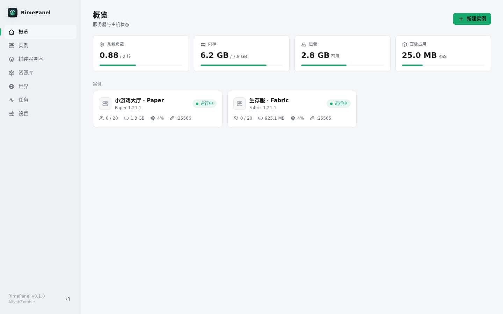

## 特点

- **极低开销**：静态编译单二进制，面板本身空载内存约 5 MB，把机器资源全留给服务端。
- **硬链接去重**：模组、核心、整合包下载后存入本地内容寻址库，实例内直接用硬链接引用。多个端共用同一批 mod 时磁盘只占一份空间；在实例内修改文件时会自动脱链，不污染原件。
- **开箱即用**：
  - 一键安装常见服务端核心（Vanilla、Paper、Purpur、Fabric、Quilt、Forge、NeoForge）。
  - 根据 Minecraft 版本自动匹配并下载对应的主版本 Java（基于 Eclipse Temurin），也支持识别系统已有 Java。
  - 支持解析 Modrinth (`.mrpack`) 和 CurseForge 整合包，自动识别并过滤纯客户端模组。
- **网页端管理**：
  - WebSocket 实时日志控制台、在线命令发送、性能监控（CPU/内存/在线人数）。
  - 在线文件管理（支持解压缩与 Monaco 代码高亮编辑）。
  - 世界管理与无损备份（触发 `save-off` 后压缩为 `.tar.zst`，支持无人在线定时备份）。
  - 响应式界面，适配桌面端、手机端甚至手表端。
- **国内网络适配**：下载源支持切换 BMCLAPI 镜像，CurseForge 整合包支持通过 MCIM 镜像拉取。

---

## 快速上手

### 1. 下载与运行

从 Release 页面下载对应架构的预编译二进制（静态链接，无需额外系统库）：

```bash
chmod +x rimepanel-linux-x86_64
./rimepanel-linux-x86_64 --bind 0.0.0.0:8080 --data /srv/rimepanel
```

用浏览器访问 `http://<服务器IP>:8080`，首次打开按提示设置管理员密码即可。

### 命令行参数

| 参数 | 环境变量 | 默认值 | 说明 |
| --- | --- | --- | --- |
| `-b`, `--bind` | `RIMEPANEL_BIND` | `0.0.0.0:8080` | Web 监听地址 |
| `-d`, `--data` | `RIMEPANEL_DATA` | `./data` | 数据存放目录 |

> **提示**：为了让硬链接去重生效，数据目录内的 `instances/` 和 `library/` 必须位于同一个文件系统分区。如果跨分区挂载，会自动降级为普通文件复制。

---

### 2. 作为 systemd 服务运行

创建 `/etc/systemd/system/rimepanel.service`：

```ini
[Unit]
Description=RimePanel Minecraft Panel
After=network-online.target
Wants=network-online.target

[Service]
Type=simple
User=minecraft
ExecStart=/opt/rimepanel/rimepanel --bind 0.0.0.0:8080 --data /srv/rimepanel
Restart=on-failure
KillMode=mixed
TimeoutStopSec=90

[Install]
WantedBy=multi-user.target
```

启动并设置开机自启：

```bash
sudo systemctl daemon-reload
sudo systemctl enable --now rimepanel
```

---

## 数据目录结构

运行后会在 `--data` 指定的路径下生成以下内容：

```text
/srv/rimepanel
├── panel.db        # SQLite 数据库（面板设置、实例元数据、配方）
├── instances/      # 各 Minecraft 服务端根目录
├── library/        # 资源库（objects/ 内容寻址文件，worlds/ 世界存档）
├── backups/        # 服务端备份文件（.tar.zst）
├── runtimes/       # 自动下载和管理的 Java 环境
├── cache/          # 版本清单与下载缓存
└── tmp/
```

---

## 界面预览

| 控制台 | 拼装与配置 |
| :---: | :---: |
| 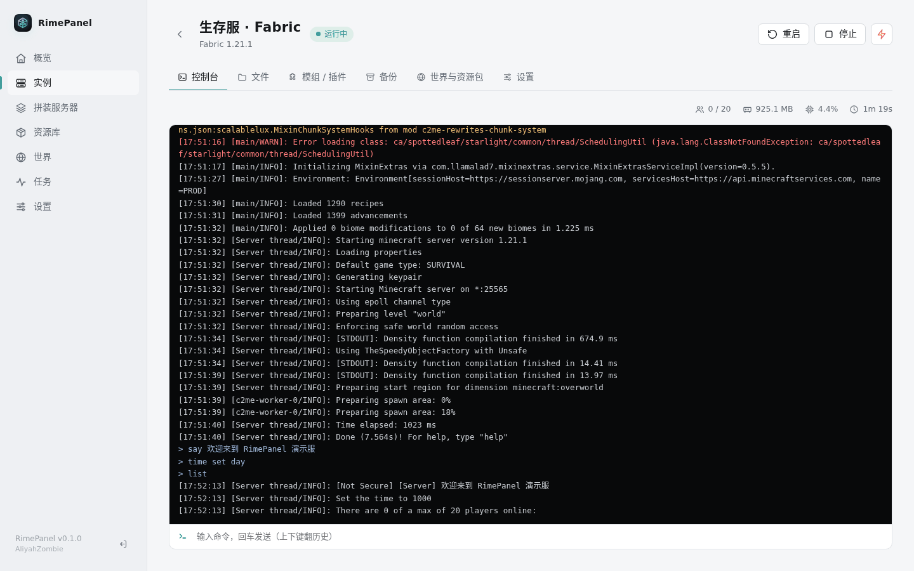 | 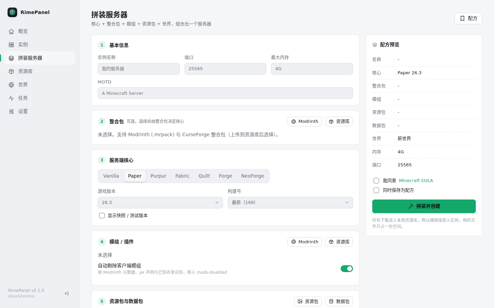 |

| 内容库 / Modrinth 搜索 | 文件管理 |
| :---: | :---: |
| 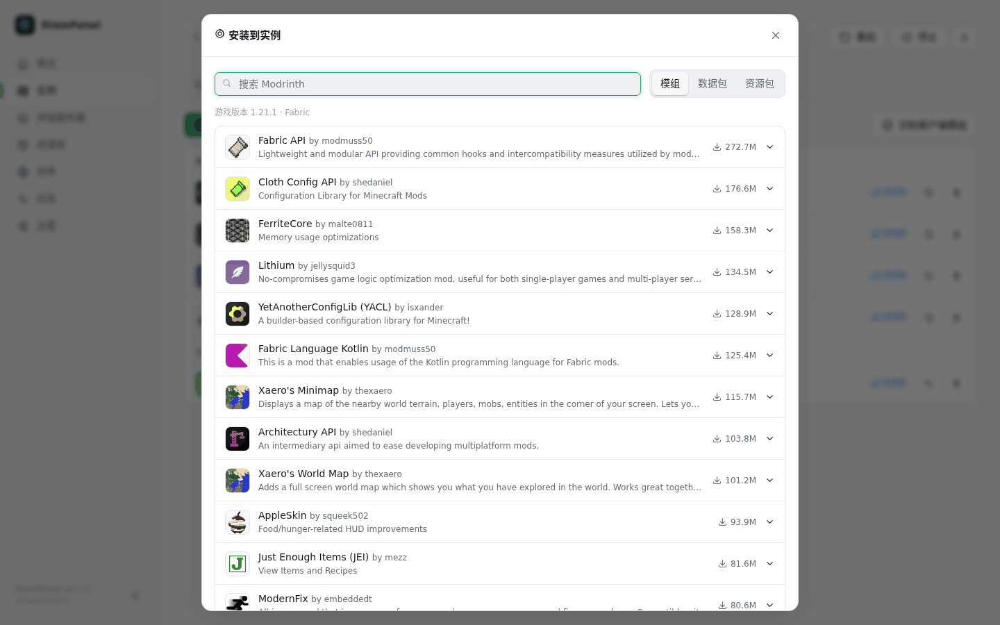 | 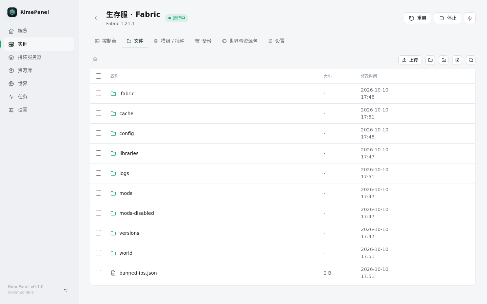 |

| 备份与还原 | 设置与运行时 |
| :---: | :---: |
| 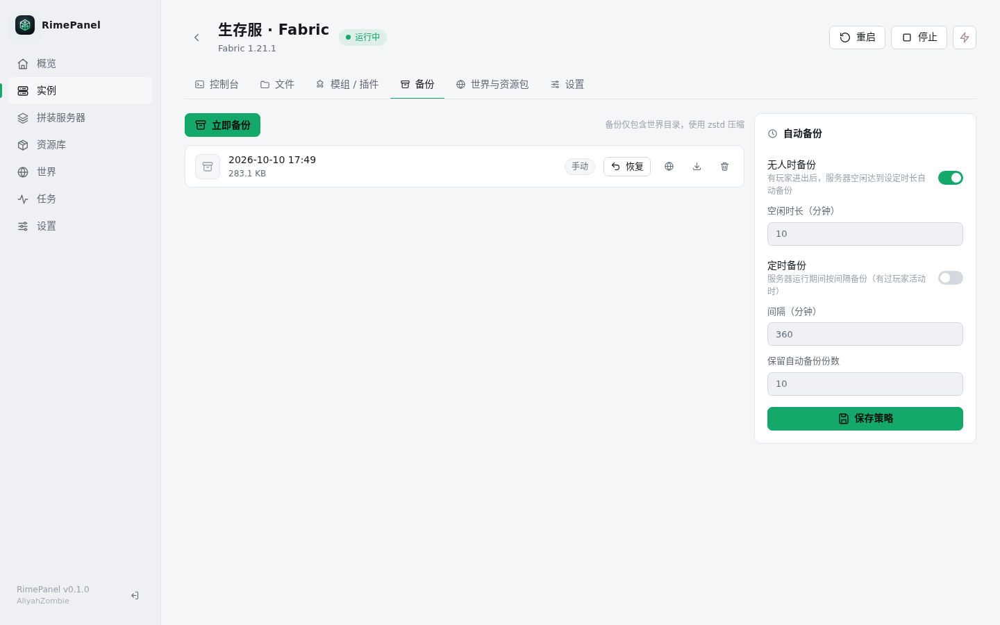 | 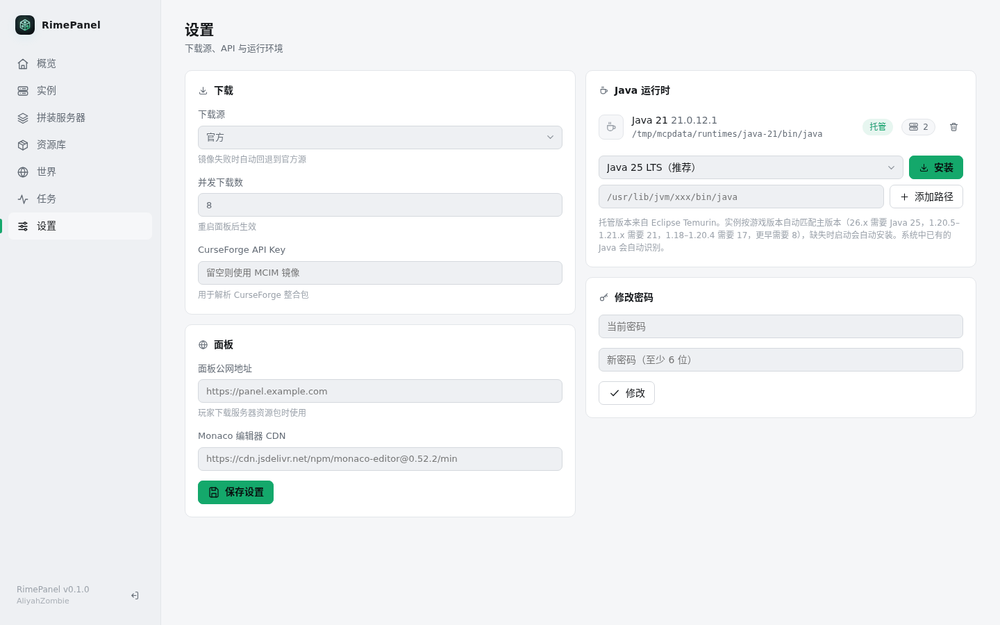 |

<details>
<summary>移动端与小屏适配预览</summary>

<p align="center">
  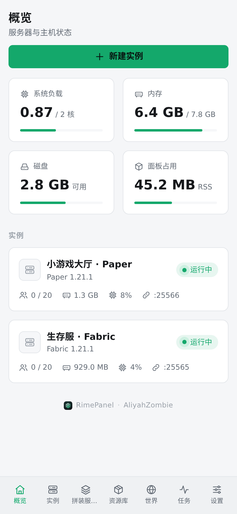
  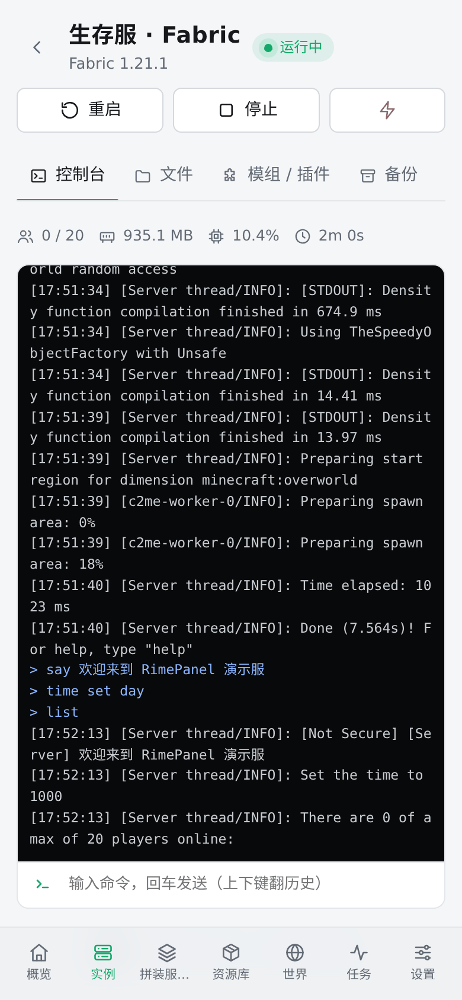
  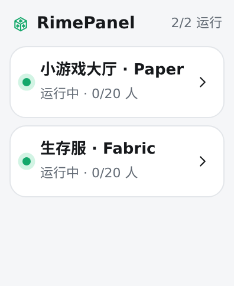
  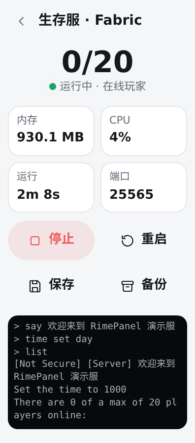
</p>

</details>

---

## 从源码编译

要求 Rust stable 工具链：

```bash
# 本地编译并运行
cargo build --release
./target/release/rimepanel

# 或使用脚本通过 Zig 交叉编译静态 musl 二进制
scripts/build-musl.sh x86_64   # 或 aarch64
```

> 前端代码位于 `web/`，采用原生 JavaScript 编写（无 npm / 打包构建步骤），编译时通过 `rust-embed` 直接内嵌进二进制中。

---

## 注意事项

- **反向代理配置**：控制台依赖 WebSocket，后台异步任务使用 SSE 推送。若使用 Nginx 反向代理，请确保正确转发 `Upgrade` 头，并对 `/api/events` 关闭缓冲（`proxy_buffering off;`）。
- **Monaco 编辑器**：默认通过 jsDelivr 加载。国内服务器若访问慢，可在「设置 → 面板」中替换为自定义 CDN；断网环境下会自动降级为纯文本编辑器。
- **国内镜像**：国内机器安装服务端或模组时，推荐在「设置 → 下载」中开启 BMCLAPI 镜像。
- **登录鉴权**：当前版本采用单管理员机制，会话保留在内存中，面板重启后需要重新登录。

## License

本项目依据相应开源协议分发。
