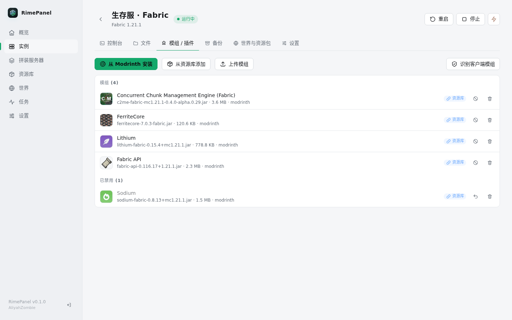
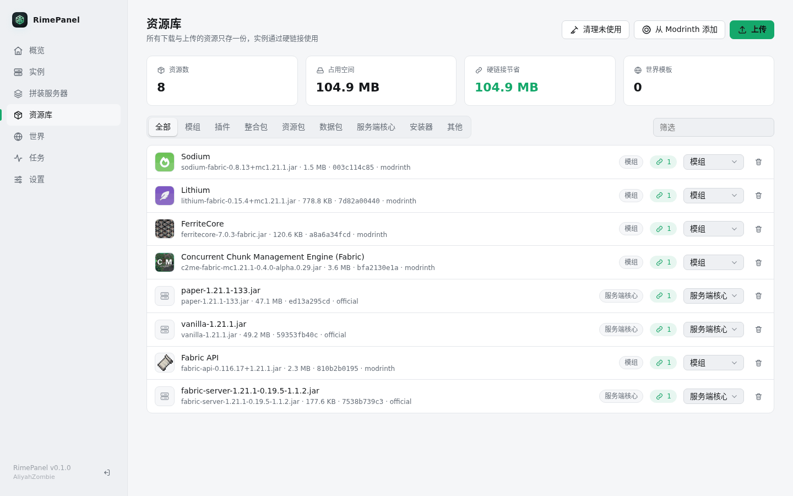

<p align="center">
  
</p>

<h1 align="center">RimePanel</h1>

<p align="center">
  用 Rust 编写的轻量 Minecraft 服务端 Web 面板<br>
  单个二进制，无需 Node / Docker / 数据库服务，开箱即用
</p>

<p align="center">
  
</p>

---

## 为什么是 RimePanel

- **轻**：单文件二进制，空载常驻内存约 5 MB（同机实测 MCSManager 面板 + 守护进程约 174 MB），把内存留给服务器本身。
- **省**：所有下载进入本地内容寻址资源库，再以**硬链接**放进实例。十个实例用同一个模组，磁盘上也只有一份。
- **快**：从官方源拉取版本列表，一键安装 Vanilla / Paper / Purpur / Fabric / Quilt / Forge / NeoForge，自动匹配并安装所需 Java。
- **随处管理**：桌面、手机、手表三套界面，按屏幕尺寸自动切换。

## 功能

| 模块 | 说明 |
| --- | --- |
| 实例管理 | 启动 / 停止 / 重启 / 强制结束，开机自启，崩溃自动重启，在线人数（Server List Ping） |
| 控制台 | 实时日志（WebSocket），命令历史，内存 / CPU / 运行时长 |
| 文件管理 | 浏览、上传下载、重命名、新建、压缩解压、删除，Monaco 编辑器在线编辑 |
| 拼装服务器 | 核心 + 整合包 + 模组 + 资源包 + 数据包 + 世界，一次组合成服务器，可存为配方复用 |
| 整合包 | Modrinth（.mrpack）与 CurseForge 整合包解析，自动剔除纯客户端模组 |
| Modrinth | 直接搜索并安装模组、数据包、资源包，按实例的游戏版本和加载器过滤 |
| 客户端模组识别 | 依据 Modrinth 元数据、jar 声明与已知名单识别，移入 `mods-disabled/`，随时可恢复 |
| 资源库 | 内容寻址存储，硬链接复用；可上传自己的文件入库；编辑实例内文件时自动断开链接，原件不受影响 |
| 世界库 | 保存 / 应用世界，备份可一键转为世界 |
| 备份 | `save-off → save-all flush → save-on` 后打包为 tar.zst；无人在线定时备份、按间隔备份、保留份数；恢复前自动快照 |
| Java 管理 | 按 Mojang 版本信息自动选择主版本，托管安装 Eclipse Temurin，也可识别系统 Java 或手动添加路径 |
| 后台任务 | 下载、安装、解压等异步执行，进度实时推送，可取消 |
| 国内网络 | 可切换 BMCLAPI 镜像（失败自动回退官方源）；无 CurseForge API Key 时走 MCIM 镜像 |

## 截图

### 控制台


### 拼装服务器


### 模组管理与 Modrinth 安装




### 资源库



### 文件管理


### 备份


### 设置与 Java 运行时


### 手机与手表

<p>
  
  
  
  
</p>

## 快速开始

下载对应架构的二进制（`rimepanel-linux-x86_64` 或 `rimepanel-linux-aarch64`），静态链接，不依赖系统库：

```bash
chmod +x rimepanel-linux-x86_64
./rimepanel-linux-x86_64 --bind 0.0.0.0:8080 --data /srv/rimepanel
```

浏览器打开 `http://服务器IP:8080`，首次访问时设置管理员密码（至少 6 位）即可。

### 参数

| 参数 | 环境变量 | 默认值 | 说明 |
| --- | --- | --- | --- |
| `--bind`, `-b` | `RIMEPANEL_BIND` | `0.0.0.0:8080` | 监听地址 |
| `--data`, `-d` | `RIMEPANEL_DATA` | `./data` | 数据目录 |

### 以 systemd 服务运行

`/etc/systemd/system/rimepanel.service`：

```ini
[Unit]
Description=RimePanel
After=network-online.target
Wants=network-online.target

[Service]
User=minecraft
ExecStart=/opt/rimepanel/rimepanel --bind 0.0.0.0:8080 --data /srv/rimepanel
Restart=on-failure
KillMode=mixed
TimeoutStopSec=90

[Install]
WantedBy=multi-user.target
```

```bash
sudo systemctl daemon-reload
sudo systemctl enable --now rimepanel
```

## 数据目录

```
/srv/rimepanel
├── panel.db        # 设置、实例配置、配方（SQLite）
├── instances/      # 各实例的服务器目录
├── library/        # 资源库（objects/ 内容寻址文件，worlds/ 世界库）
├── backups/        # 备份（tar.zst）
├── runtimes/       # 托管的 Java
├── cache/          # 版本清单等缓存
└── tmp/
```

> 资源库和实例必须在**同一个文件系统**上硬链接才会生效。放在同一个 `--data` 目录下即可；跨盘时会自动改为复制。

## 从源码构建

需要 Rust stable：

```bash
cargo build --release
./target/release/rimepanel
```

前端为无构建步骤的原生 JavaScript（`web/`），编译时通过 rust-embed 打包进二进制。

静态发布包（musl）可用 zig 交叉编译：

```bash
scripts/build-musl.sh x86_64   # 或 aarch64，输出到 dist/
```

## 使用提示

- **Monaco 编辑器**默认从 jsDelivr 加载，网络不佳时可在「设置 → 面板」换成自己的 CDN；加载失败会自动退回纯文本编辑。
- **中国大陆**开服建议在「设置 → 下载」切到 BMCLAPI 镜像。
- **资源包分发**：要让玩家从面板下载服务器资源包，需先在设置中填写面板公网地址。
- **反向代理**：控制台使用 WebSocket、任务进度使用 SSE，Nginx 需转发 `Upgrade` 头并关闭对 `/api/events` 的缓冲。
- 当前为单管理员账号，登录会话保存在内存中，面板重启后需重新登录。

## 技术栈

axum · tokio · rusqlite（bundled SQLite）· rust-embed · reqwest（rustls）· argon2 · zstd

---

<p align="center"><sub>RimePanel · AliyahZombie</sub></p>
